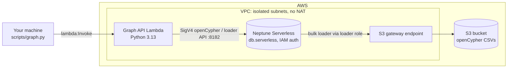
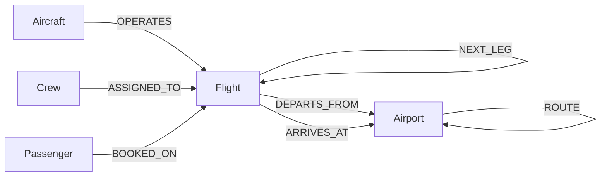

# Airline Disruption Impact Graph on Amazon Neptune Serverless

When one flight runs late, what else breaks? This project answers that with a graph:
a synthetic one-day schedule for a Southwest-style network hubbed at **Dallas Love Field (DAL)**,
loaded into **Amazon Neptune Serverless** and queried with **openCypher**. Everything is
deployed with the **AWS CDK (Python)**.

Give it a flight and a delay, and it returns:

1. **Aircraft ripple**: later legs flown by the same aircraft, with the delay reduced by any spare turn time
2. **Crew impact**: crews who change aircraft and carry the delay onto *other* tails, plus duty-limit breaches
3. **Misconnected passengers**: booked connections that no longer meet minimum connect time
4. **Rebooking options**: direct and one-stop alternatives with open seats, ranked by arrival

> All schedule, fleet, crew and passenger data is synthetic. Only the airport codes and
> coordinates are real. This project is not affiliated with Southwest Airlines.

## Why a graph?

Each question above is a multi-hop traversal: flight → aircraft → next flight, flight → crew →
that crew's next flight, flight → passenger → their next flight → destination. In SQL each one
is a chain of recursive self-joins. Here each is a short `MATCH` pattern, and the questions can
be combined (a crew-induced delay creates new misconnects) without remodelling anything.

## Architecture



| Component | Purpose |
|---|---|
| VPC (2 AZs, isolated subnets) | No NAT gateway and no internet path. The S3 gateway endpoint lets the bulk loader reach S3. |
| Neptune Serverless cluster | 1 writer instance, `db.serverless`, 1–8 NCU by default, IAM auth, encrypted |
| S3 bucket + `BucketDeployment` | Uploads the generated CSVs at deploy time |
| Loader IAM role | Associated with the cluster; read-only on the bucket |
| Graph API Lambda | The only path into the cluster. Runs bulk loads, named queries, ad-hoc Cypher and the impact analysis. Uses boto3's `neptunedata` client, which signs requests with SigV4. |

## Graph model



| Element | Count | Notable properties |
|---|---|---|
| `Airport` | 26 | `code`, `city`, `isHub` |
| `Aircraft` | 40 | `tail`, `type` (737-700 / -800 / MAX 8), `seats` |
| `Flight` | 239 | `flightId`, `origin`, `dest`, `schedDepMin`, `schedArrMin`, `tail`, `legSeq`, `seatsAvailable` |
| `Crew` | 481 | `role`, `pairingId`, `dutyLimitMin` |
| `Passenger` | ~27.8k | `tier` (A-List Preferred / A-List / Member / None) |
| `BOOKED_ON` | ~32.3k | `pnr`, `segment`. About 4.5k are second legs of connections. |
| `NEXT_LEG` / `ASSIGNED_TO` / `ROUTE` | 199 / 1,374 / 132 | `turnMin` / `seq` / `distanceMi` |

Times are stored as **minutes after midnight in hub (Central) time** (plus `HH:MM` strings for
display), which keeps connection arithmetic simple. About 83% of flights touch DAL. The rest
are point-to-point routes between focus cities.

## Deploy

**Cost note:** Neptune Serverless has a floor of **1 NCU** and does not scale to zero, so the
cluster bills every hour it exists, even when idle. See the
[Neptune pricing page](https://aws.amazon.com/neptune/pricing/) and run `cdk destroy` when you're done.

Prerequisites: AWS credentials, Python 3.11+, Node 18+ and the CDK CLI (`npm i -g aws-cdk`).

```bash
python -m venv .venv && source .venv/bin/activate
pip install -r requirements-dev.txt

python -m datagen.generate          # optional: app.py generates the data if it's missing
cdk bootstrap                       # once per account/region
cdk deploy                          # ~15-20 min, mostly the Neptune cluster
```

Optional context overrides:

```bash
cdk deploy -c neptuneEngineVersion=1.4.7.1 -c minNcu=1 -c maxNcu=16
```

## Load and explore

```bash
python scripts/graph.py load                  # starts two bulk-load jobs (nodes, then edges) and polls
python scripts/graph.py query summary
python scripts/graph.py query hub_connections --params '{"limit": 5}'
python scripts/graph.py query tightest_turns
python scripts/graph.py query aircraft_rotation --params '{"tail": "N927DM"}'
python scripts/graph.py query downstream_legs --params '{"flightId": "WN1091"}'
python scripts/graph.py cypher "MATCH (f:Flight)-[:DEPARTS_FROM]->(:Airport {code:'DAL'}) RETURN count(f) AS departures"
python scripts/graph.py list                  # all named queries and their default params
```

The named queries live in [`functions/graph_api/queries.py`](functions/graph_api/queries.py).

## Disruption impact

```bash
python scripts/graph.py impact WN1091 --delay 180
python scripts/graph.py impact WN1091 --delay 180 --json    # full report
```

Sample output for the generated dataset (seed 42). This was produced by running the impact
pipeline against the test suite's in-memory version of the queries, so the live cluster's
results should match:

```
WN1091 TPA-DAL (aircraft N927DM) delayed 180 min

  Flights delayed            10  (aircraft ripple 5, crew-induced 5)
  Crew pairings affected     4  (duty-limit breaches 1)
  Misconnected passengers    202  (A-List 17)

Crew pairings
pairing  flights                               dutyEnd  limit    breach
-------  ------------------------------------  -------  -------  ------
PR0023   WN1091 > WN2830* > WN1417* > WN4260*  19:10    18:45    True
PR0004   WN696 > WN4815 > WN3135 > WN2895      16:25    18:00    False
PR0046   WN4115 > WN4948*                      23:40    01:50+1  False
PR0066   WN3067 > WN4259*                      01:20+1  05:35+1  False
  * crew-induced delay (crew arrives late on another aircraft)

Misconnects (first rows)
inbound  at   outbound  to   pax  newArr  dep    slack
-------  ---  --------  ---  ---  ------  -----  -----
WN3067   DAL  WN3532    PHX  24   23:30   21:30  -120
WN2895   DAL  WN1029    SAT  18   16:10   14:20  -110
WN2895   DAL  WN1037    MDW  16   16:10   15:35  -35
...

Rebooking options (best 3 by arrival)
market   notBefore  flights        dep      arr      seats  delayed
-------  ---------  -------------  -------  -------  -----  -------
DAL-ATL  12:40      WN1490         13:25    15:25    20     False
DAL-ATL  12:40      WN1690+WN2576  13:05    17:45    36     False
DAL-BWI  12:40      WN4816         13:20    16:25    40     False
...
```

Note crew pairing `PR0023`: that crew flies the late WN1091 into DAL and then changes aircraft.
That makes three flights late that the aircraft ripple never touched, and the crew ends up past
its duty limit.

### How it works

1. `AIRCRAFT_RIPPLE` finds the aircraft's remaining legs. `propagate_aircraft_delay` pushes the delay forward, reducing it by any turn time beyond the 35-minute minimum.
2. `CREW_SEQUENCES` finds every crew on a delayed flight and its full pairing. `crew_impacts` adds delays where a late crew holds up a different aircraft (30-minute crew connect) and checks projected duty end against the limit.
3. `CONNECTIONS_FROM` finds passengers whose next booked flight leaves the inbound flight's arrival airport. `find_misconnects` flags connections under 30 minutes after applying delays to both flights. Through passengers who stay on the same aircraft are excluded.
4. `REBOOK_DIRECT` and `REBOOK_ONE_STOP` (both `UNWIND` over a batch of requests) find options with open seats, and `best_options` ranks them by projected arrival.

The Cypher lives in `queries.py` and the scheduling rules in `impact.py`, which has no AWS
dependencies and is unit-tested directly.

## Tests

```bash
pytest -q
```

- `tests/test_datagen.py` checks the generated schedule: rotations are continuous, turns meet the minimum, every flight is crewed exactly once within duty limits, no flight is overbooked, connections are legal, and every edge points at an existing node.
- `tests/test_impact.py` unit-tests the delay, crew, misconnect and rebooking rules, then runs the full `impact` action end to end against `tests/fake_graph.py` (in-memory versions of each query).

CI (`.github/workflows/ci.yml`) runs the tests and `cdk synth` on every push.

## Troubleshooting

- **A command hangs or times out:** run `python scripts/graph.py diagnose`. It shows whether the Lambda can reach Neptune, lists recent bulk-load jobs with their status, and counts loaded nodes.
- **Engine version not offered in your region:** `aws neptune describe-db-engine-versions --engine neptune --query "DBEngineVersions[].EngineVersion"`, then `cdk deploy -c neptuneEngineVersion=<version>`.
- **Access denied right after a deploy:** IAM changes can take a few minutes to apply; retry.

## Simplifications

- One service day. Times are hub-local, with no time-zone conversion.
- Duty limits are a flat 13-hour flight duty period from report time, not the full FAA Part 117 tables.
- Crew-induced delays are reported in a single pass. They aren't fed back into further aircraft or crew propagation.
- Rebooking checks seat counts but doesn't reserve seats, so two misconnect groups can be offered the same seats.
- There are no cancellations, spare aircraft or reserve crews yet. These are natural next steps, along with a Neptune graph notebook and a Bedrock agent that calls the `impact` action as a tool.

## Teardown

```bash
cdk destroy
```

The cluster, instance, bucket (and its objects) and log group are all set to be deleted with
the stack, with no final snapshot.

## Project layout

```
app.py                       CDK app (generates data on first synth)
infra/neptune_stack.py       VPC, Neptune Serverless, S3, IAM, Lambda
functions/graph_api/         Lambda: handler.py, queries.py (openCypher), impact.py (rules)
datagen/                     Synthetic network, schedule, crew and passenger generator
scripts/graph.py             CLI that invokes the Lambda
tests/                       pytest suite + in-memory query stand-ins
```
