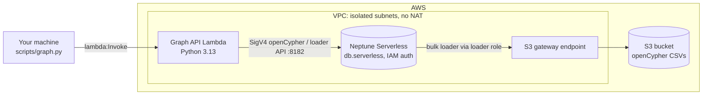
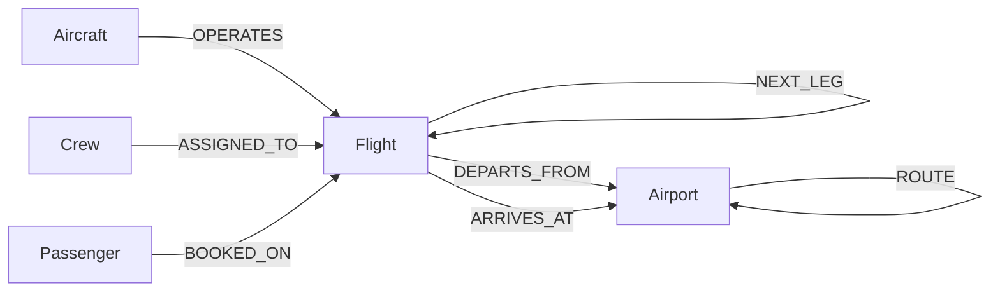

# Airline Disruption Impact Graph on Amazon Neptune Serverless

When one flight runs late, what else breaks? This project answers that with a graph:
a synthetic one-day schedule for a Southwest-style network hubbed at **Dallas Love Field (DAL)**,
loaded into **Amazon Neptune Serverless** and queried with **openCypher**. Everything is
deployed with the **AWS CDK (Python)**.

Give it a flight and a delay—through the CLI or a read-only AI operations assistant—and it returns:

1. **Aircraft ripple**: later legs flown by the same aircraft, with the delay reduced by any spare turn time
2. **Crew impact**: crews who change aircraft and carry the delay onto *other* tails, plus duty-limit breaches
3. **Misconnected passengers**: booked connections that no longer meet minimum connect time
4. **Rebooking options**: direct and one-stop alternatives with open seats, ranked by arrival

The solution also offers interactive HTML visualizations, an optional Neptune Graph Explorer notebook, and a Strands-based AI assistant that runs locally or on Amazon Bedrock AgentCore (Runtime, Gateway, and Memory).

> All schedule, fleet, crew and passenger data is synthetic. Only the airport codes and
> coordinates are real. This project is not affiliated with Southwest Airlines.

## Why a graph?

Each question above is a multi-hop traversal: flight → aircraft → next flight, flight → crew →
that crew's next flight, flight → passenger → their next flight → destination. In SQL each one
is a chain of recursive self-joins. Here each is a short `MATCH` pattern, and the questions can
be combined (a crew-induced delay creates new misconnects) without remodelling anything.

## Architecture

The deployment separates the core graph, optional visualization notebook, and optional hosted AI assistant into independent CDK stacks. The local CLI and AI assistant use read-only graph actions for analysis; the hosted assistant exposes six approved tools through an IAM-protected MCP gateway.



| Component | Purpose |
|---|---|
| VPC (2 AZs, isolated subnets) | No NAT gateway and no internet path. The S3 gateway endpoint lets the bulk loader reach S3. |
| Neptune Serverless cluster | 1 writer instance, `db.serverless`, 1–8 NCU by default, IAM auth, encrypted |
| S3 bucket + `BucketDeployment` | Uploads the generated CSVs at deploy time |
| Loader IAM role | Associated with the cluster; read-only on the bucket |
| Neptune workbench notebook (separate optional stack, on by default) | Jupyter with graph-notebook and **Graph Explorer**, connected to the cluster with IAM auth. It has an interface in the isolated subnet to reach Neptune, and SageMaker-provided internet access to install its software. |
| Graph API Lambda | The only path into the cluster. Runs bulk loads, named queries, ad-hoc Cypher and the impact analysis. Uses boto3's `neptunedata` client, which signs requests with SigV4. |

## Graph model



| Element | Count | Notable properties |
|---|---|---|
| `Airport` | 26 | `code`, `city`, `isHub` |
| `Aircraft` | 40 | `tail`, `type` (737-700 / -800 / MAX 8), `seats` |
| `Flight` | 234 | `flightId`, `origin`, `dest`, `schedDepMin`, `schedArrMin`, `tail`, `legSeq`, `seatsAvailable` |
| `Crew` | 472 | `role`, `pairingId`, `dutyLimitMin` |
| `Passenger` | ~27.4k | `tier` (A-List Preferred / A-List / Member / None) |
| `BOOKED_ON` | ~31.7k | `pnr`, `segment`. About 4.3k are second legs of connections. |
| `NEXT_LEG` / `ASSIGNED_TO` / `ROUTE` | 194 / 1,333 / 132 | `turnMin` / `seq` / `distanceMi` |

Times are stored as **minutes after midnight in hub (Central) time** (plus `HH:MM` strings for
display), which keeps connection arithmetic simple. About 81% of flights touch DAL. The rest
are point-to-point routes between focus cities.

## Deploy

**Cost note:** Neptune Serverless has a floor of **1 NCU** and does not scale to zero, so the
cluster bills every hour it exists, even when idle. See the
[Neptune pricing page](https://aws.amazon.com/neptune/pricing/) and run `cdk destroy --all` when you're done.

Prerequisites: AWS credentials, Python 3.11+, Node 18+ and the CDK CLI (`npm i -g aws-cdk`).

```bash
python -m venv .venv && source .venv/bin/activate
pip install -r requirements-dev.txt

python -m datagen.generate          # optional: app.py generates the data if it's missing
cdk bootstrap                       # once per account/region
cdk deploy --all                    # ~15-20 min, mostly the Neptune cluster
```

`cdk deploy --all` creates up to three stacks: the core graph (`NeptuneAirlineDisruptionStack`),
the Graph Explorer notebook (`NeptuneAirlineGraphExplorerStack`) and the hosted AI agent
(`NeptuneAirlineAgentCoreStack`). The first synth also builds the agent's code package for
Linux arm64 (`build/agent_runtime.zip`), which downloads its Python dependencies once.

Optional context overrides:

```bash
cdk deploy --all -c neptuneEngineVersion=1.4.7.1 -c minNcu=1 -c maxNcu=16
cdk deploy --all -c graphExplorer=false   # skip the Graph Explorer notebook
cdk deploy --all -c agentCore=false       # skip the hosted AI agent
```

## Load and explore

```bash
python scripts/graph.py load                  # starts two bulk-load jobs (nodes, then edges) and polls
python scripts/graph.py query summary
python scripts/graph.py query hub_connections --params '{"limit": 5}'
python scripts/graph.py query tightest_turns
python scripts/graph.py query aircraft_rotation --params '{"tail": "N925DM"}'
python scripts/graph.py query downstream_legs --params '{"flightId": "WN3553"}'
python scripts/graph.py cypher "MATCH (f:Flight)-[:DEPARTS_FROM]->(:Airport {code:'DAL'}) RETURN count(f) AS departures"
python scripts/graph.py list                  # all named queries and their default params
```

The named queries live in [`functions/graph_api/queries.py`](functions/graph_api/queries.py).

## Disruption impact

```bash
python scripts/graph.py impact WN3553 --delay 180
python scripts/graph.py impact WN3553 --delay 180 --json    # full report
```

Any flight number works; `query hub_connections` lists busy ones. Sample output for the
generated dataset (seed 42), produced by running the impact pipeline against the test suite's
in-memory version of the queries:

```
WN3553 PHX-DAL (aircraft N925DM) delayed 180 min

  Flights delayed            9  (aircraft ripple 6, crew-induced 3)
  Crew pairings affected     5  (duty-limit breaches 2)
  Misconnected passengers    139  (A-List 13)

Crew pairings
pairing  flights                           dutyEnd  limit    breach
-------  --------------------------------  -------  -------  ------
PR0020   WN3553 > WN3952 > WN663*          18:45    18:40    True
PR0029   WN4289 > WN3670 > WN3950 > WN662  21:20    19:05    True
PR0048   WN526 > WN1828* > WN3341*         22:55    01:35+1  False
...
  * crew-induced delay (crew arrives late on another aircraft)

Misconnects (first rows)
inbound  at   outbound  to   pax  newArr  dep    slack
-------  ---  --------  ---  ---  ------  -----  -----
WN354    DAL  WN2578    LAX  19   22:50   21:20  -90
WN354    DAL  WN3298    MCI  11   22:50   21:30  -80
WN3553   DAL  WN2267    DEN  8    12:00   09:45  -135
...

Rebooking options (best 3 by arrival)
market   notBefore  flights        dep    arr      seats  delayed
-------  ---------  -------------  -----  -------  -----  -------
DAL-ATL  12:30      WN2381         13:00  15:00    21     False
DAL-ATL  12:30      WN1490         19:35  21:35    25     False
DAL-ATL  12:30      WN2089         21:05  23:05    46     False
...
```

Note crew pairing `PR0048`: that crew flies the late WN526 into DAL and then changes aircraft,
making two flights late that the aircraft ripple never touched. Pairing `PR0020` ends up past
its duty limit.

### Explore it in Graph Explorer

The stack includes a Neptune workbench notebook (`aws-neptune-airline-disruption`, an
ml.t3.medium) with [Graph Explorer](https://docs.aws.amazon.com/neptune/latest/userguide/visualization-graph-explorer.html)
already connected to the cluster. It lives in its own stack, `NeptuneAirlineGraphExplorerStack`,
so if it ever fails to create, only the notebook rolls back and the cluster stays up.
After `cdk deploy --all`, wait until the notebook's status is
**InService** (its first start installs the software and takes several minutes), then:

1. Open the **Neptune console**, choose **Notebooks**, and select `aws-neptune-airline-disruption`.
2. Choose **Actions → Open Graph Explorer**.
3. Search for a node, for example a `Flight` with `flightId` WN3553, and expand its neighbours to
   follow the aircraft, crews and passengers.

The same notebook also offers **Open JupyterLab**, with Neptune's starter notebooks and the
`%%oc` openCypher magic, whose results can be shown as a graph.

The notebook bills about $0.05 an hour while it is running (us-east-1). Stop it from the console
when you're not using it, or deploy with `-c graphExplorer=false` to leave it out.
`cdk destroy --all` removes it with the rest. If the notebook fails to start, its setup log is in
CloudWatch: log group `/aws/sagemaker/NotebookInstances`, stream
`aws-neptune-airline-disruption/LifecycleConfigOnStart`.

### Visualize it

```bash
python scripts/graph.py visualize impact WN3553 --delay 180   # writes impact-WN3553-180.html and opens it
python scripts/graph.py visualize network                     # writes network.html: the route map
```

Each command pulls the relevant part of the graph through the Lambda and writes a single
interactive HTML page (drag, zoom, hover for details). Nothing extra is deployed.

- **impact**: one row per aircraft in the cascade, flights placed left to right by scheduled
  departure and coloured by cause (disrupted, same aircraft, crew changed aircraft). Crew
  pairings link to every leg they work (red ring = duty-limit breach); misconnected passenger
  groups link each late inbound flight to the onward flight they miss, shown in a band below.
- **network**: airports placed by real latitude and longitude, sized by daily departures, with
  the hub's routes highlighted.

Options: `--out <file>` to choose the file name, `--no-open` to skip opening the browser. The page
loads its drawing library (vis-network) from unpkg.com, so viewing it needs internet access.

### Ask the AI agent

An operations assistant built with [Strands Agents](https://strandsagents.com) and Claude on
Amazon Bedrock. Describe a disruption in plain English; it calls read-only tools backed by the
graph API Lambda, reasons across the results and recommends what to do. Nothing new is
deployed: it runs on your laptop.

```bash
pip install -r requirements-agent.txt     # already included in requirements-dev.txt
python -m agent.chat                      # interactive; follow-up questions keep context
python -m agent.chat --ask "WN3553 is going to be 3 hours late. What should I do first?"
```

Good questions to try:

- "WN3553 is going to be 3 hours late. What's the damage and what should I do first?"
- "How late can WN3553 get before any passenger misconnects?" (it runs several scenarios)
- "Which connections through DAL carry the most passengers?"
- "Find afternoon flights from DAL to LAS with open seats."

| Tool | What it does |
|---|---|
| `analyze_disruption` | Full cascade for a flight and delay: flights, crews, duty breaches, misconnects, rebooking |
| `get_flight` / `get_aircraft_day` | One flight's details and crew / one aircraft's whole day |
| `find_flights` | Schedule search by airports and departure window (fixed query template) |
| `find_rebooking` | Direct and one-stop options with open seats, ranked by arrival |
| `busiest_connections` | Connecting-passenger hot spots at a hub |

Guardrails: the tools are read-only (no load, clear or free-form queries); the system prompt
requires every number to come from a tool result; the agent recommends and the controller
decides. The tool logic lives in `agent/actions.py` and is unit-tested against the in-memory
graph; `agent/tools.py` wraps it for the agent and `agent/prompt.py` holds its instructions.

Model: the SDK's default Claude model on Bedrock (Claude Sonnet 4.6 at the time of writing).
Use another model or inference profile with `export AGENT_MODEL_ID=<id>`. Your AWS identity
needs `bedrock:InvokeModel*` and `lambda:InvokeFunction`. If Bedrock answers "access denied",
open the Bedrock console's model catalog once and complete Anthropic's first-use form.

### Run the agent on Amazon Bedrock AgentCore

The same agent, hosted: `NeptuneAirlineAgentCoreStack` deploys it to **AgentCore Runtime**,
publishes the six tools through **AgentCore Gateway** as MCP tools, and keeps each chat's history
in **AgentCore Memory**.

```
python -m agent.chat --remote
        │  InvokeAgentRuntime (one chat = one runtime session)
        ▼
AgentCore Runtime ── Strands agent + Claude on Bedrock ── AgentCore Memory (chat history)
        │  MCP over HTTPS, SigV4-signed with the runtime's role (gateway authorizer: AWS_IAM)
        ▼
AgentCore Gateway ── target "graph": 6 tools ──► tools Lambda ──► graph API Lambda ──► Neptune
```

```bash
cdk deploy --all                         # includes the agent stack
python -m agent.chat --remote            # chat with the hosted agent
python -m agent.chat --remote --ask "WN3553 is going to be 3 hours late. What should I do first?"
```

The remote chat prints the hosted agent's answer and the tools it used. Follow-up questions in
the same chat share a runtime session, so the agent remembers the conversation.

| Piece | What it is |
|---|---|
| `agent/runtime_app.py` | The Runtime service (`main.py` in the package): Strands agent, tools from the gateway via MCP, Memory session manager |
| `agent/gateway_lambda.py` | Gateway target: maps MCP tool calls onto `agent/actions.py`, the same code the local agent uses |
| `agent/tool_schemas.py` | Tool names, descriptions and input schemas, used for the gateway target and checked against `actions.py` by tests |
| `scripts/build_agent_package.py` | Builds `build/agent_runtime.zip`: Linux arm64 wheels for Python 3.13 plus the agent code (no Docker needed) |
| `infra/agentcore_stack.py` | Runtime, Gateway, GatewayTarget, Memory, the tools Lambda and least-privilege IAM roles |

Security: the gateway only accepts SigV4-signed calls (the runtime's role has
`bedrock-agentcore:InvokeGateway` on that one gateway), the tools stay read-only, and the
runtime role can only invoke Bedrock models, use its own memory and write its own logs.

Cost: AgentCore Runtime, Gateway and Memory bill by usage (requests, compute while the agent is
working, memory events), so the agent stack has no meaningful idle cost; each conversation
adds Bedrock model usage. Pin a model with `cdk deploy --all -c agentModelId=<id>`.

Logs: the runtime writes to CloudWatch under `/aws/bedrock-agentcore/runtimes/`, and the tools
Lambda logs each tool call (name and arguments).

### Web app

A browser UI for the agent, built with [Streamlit](https://streamlit.io): chat on the left, a
live impact dashboard on the right.

```bash
pip install -r requirements-ui.txt
streamlit run ui/app.py          # opens http://localhost:8501
```

- **Chat** with the agent hosted on AgentCore (default) or the local one (sidebar switch).
  Each answer shows the tools the agent used; example questions are one click away.
- **Dashboard** for the disruption the agent last simulated: flights delayed, crew duty
  breaches, misconnected passengers and rebooking markets; the interactive cascade drawing;
  and tables for crew duty, missed connections and rebooking options. Ask "what if it's only
  90 minutes?" and it redraws. Earlier scenarios stay in the selector so you can compare.
- Before the first analysis it shows the route network.

It runs on your laptop with your AWS credentials (same as the CLI) and costs nothing beyond the
agent and graph calls it makes. The drawing loads its library from unpkg.com, so it needs
internet access. Code: `ui/app.py` (layout) and `ui/backend.py` (agent calls and dashboard
data, unit-tested); CI also runs the whole app headless with a stand-in agent.

### How it works

1. `AIRCRAFT_RIPPLE` finds the aircraft's remaining legs. `propagate_aircraft_delay` pushes the delay forward, reducing it by any turn time beyond the 35-minute minimum.
2. `CREW_SEQUENCES` finds every crew on a delayed flight and its full pairing. `crew_impacts` adds delays where a late crew holds up a different aircraft (30-minute crew connect) and checks projected duty end against the limit.
3. `CONNECTIONS_FROM` finds passengers whose next booked flight leaves the inbound flight's arrival airport. `find_misconnects` flags connections under 30 minutes after applying delays to both flights. Through passengers who stay on the same aircraft are excluded.
4. `REBOOK_DIRECT` and `REBOOK_ONE_STOP` (both `UNWIND` over a batch of requests) find options with open seats, and `best_options` ranks them by projected arrival.

The Cypher lives in `queries.py` and the scheduling rules in `impact.py`, which has no AWS
dependencies and is unit-tested directly.

## Tests

```bash
pytest -q
```

- `tests/test_datagen.py` checks the generated schedule: rotations are continuous, turns meet the minimum, every flight is crewed exactly once within duty limits, no flight is overbooked, connections are legal, and every edge points at an existing node.
- `tests/test_impact.py` unit-tests the delay, crew, misconnect and rebooking rules, then runs the full `impact` action end to end against `tests/fake_graph.py` (in-memory versions of each query).
- `tests/test_visualize.py` validates graph visualization data generation.
- The agent tool implementations and hosted tool schemas are tested independently of live AWS resources.

CI (`.github/workflows/ci.yml`) runs the tests and `cdk synth` on every push.

## Troubleshooting

- **A command hangs or times out:** run `python scripts/graph.py diagnose`. It shows whether the Lambda can reach Neptune, lists recent bulk-load jobs with their status, and counts loaded nodes.
- **Engine version not offered in your region:** `aws neptune describe-db-engine-versions --engine neptune --query "DBEngineVersions[].EngineVersion"`, then `cdk deploy --all -c neptuneEngineVersion=<version>`.
- **Access denied right after a deploy:** IAM changes can take a few minutes to apply; retry.

## Simplifications

- One service day. Times are hub-local, with no time-zone conversion.
- Duty limits are a flat 13-hour flight duty period from report time, not the full FAA Part 117 tables.
- Crew-induced delays are reported in a single pass. They aren't fed back into further aircraft or crew propagation.
- Rebooking checks seat counts but doesn't reserve seats, so two misconnect groups can be offered the same seats.
- There are no cancellations, spare aircraft or reserve crews yet. These are potential future enhancements; the Neptune Graph Explorer notebook and Bedrock-powered agent are already implemented.

## Teardown

```bash
cdk destroy --all
```

The cluster, instance, bucket (and its objects), log groups, the Graph Explorer notebook and
the AgentCore runtime, gateway and memory are all deleted with their stacks, with no final
snapshot.

## Project layout

```
app.py                       CDK app (generates data on first synth)
infra/neptune_stack.py       VPC, Neptune Serverless, S3, IAM, Lambda
functions/graph_api/         Lambda: handler.py, queries.py (openCypher), impact.py (rules)
datagen/                     Synthetic network, schedule, crew and passenger generator
scripts/graph.py             CLI that invokes the Lambda
scripts/visualize.py         Builds the interactive HTML views
agent/                       AI operations agent (Strands + Bedrock): tools, prompt, chat CLI,
                             AgentCore runtime app and gateway tools Lambda
infra/graph_explorer_stack.py  Neptune workbench notebook with Graph Explorer
infra/agentcore_stack.py     AgentCore Runtime, Gateway, Memory for the hosted agent
scripts/build_agent_package.py  Builds the AgentCore code package (Linux arm64)
ui/                          Streamlit web app: chat + impact dashboard
tests/                       pytest suite + in-memory query stand-ins
```
